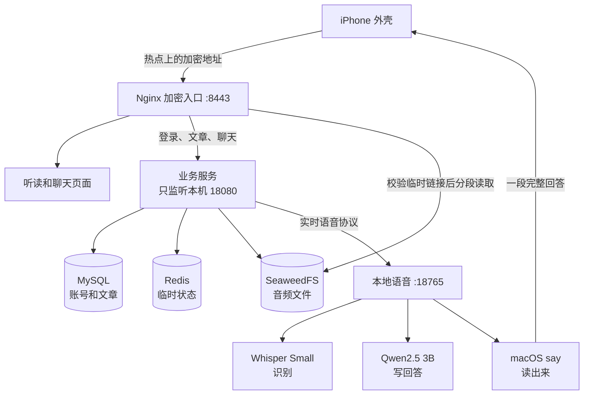

# 当前空间架构

这是这台 Mac 上正在跑的本地测试结构。手机和本机在同一个热点里。线上环境没有接进来。

页面、业务服务、数据库、临时状态和音频都在这一台 Mac 的本地 Kubernetes 里。业务服务不直接对手机开放，手机只进 Nginx。

语音不在集群里。业务服务把通话转到本机的一个小服务：Whisper Small 负责听，Qwen2.5 3B 负责写一两句回答，macOS 自带的 say 负责读。中文声音是 Tingting，英文声音是 Samantha。

听读音频放在 SeaweedFS。手机拿到的是 Nginx 上的临时链接，过期或签名不对就读不到文件。

数据线只作为打不开加密地址时的备用页面，不是这张图的主路径。云端实时语音没有接入。
